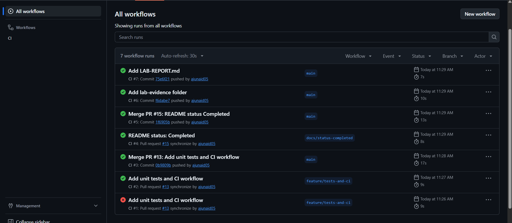

# Lab Evidence

Screenshots of key steps for Lab Assignment 4:

- Merge conflict before resolution (PR #15)
- Merge conflict after resolution
- GitHub Actions failed run
- GitHub Actions successful run
- Commit graph
- Issues with labels
- Pull request review
- v1.0.0 release page

## Part E: GitHub Actions runs (failed and successful)

Run #1 on `feature/tests-and-ci` failed because `complete_task` returned `True`
for an already-completed task. After the fix (run #2) the workflow passed, and
all later runs on `main` also passed.

